<!-- 1. ANIMATED TYPING HEADER -->

<!-- 2. HOLOGRAPHIC TERMINAL BANNER (Root Path: ./terminal.svg) -->

 

<!-- 3. LIVE GITHUB STREAK & TELEMETRY CARDS -->

  
  

<!-- 4. CONTRIBUTION SNAKE ANIMATION -->
<picture>
  <source media="(prefers-color-scheme: dark)" srcset="https://raw.githubusercontent.com/rohan-sheikh05/rohan-sheikh05/output/github-contribution-grid-snake-dark.svg" />
  <source media="(prefers-color-scheme: light)" srcset="https://raw.githubusercontent.com/rohan-sheikh05/rohan-sheikh05/output/github-contribution-grid-snake.svg" />
  
</picture>

 

<!-- 5. NAVIGATION & CONTACT BAR -->

  &nbsp;
  &nbsp;
  &nbsp;
  &nbsp;
  &nbsp;
  

---

## ⚡ About

Assalamualaikum! I am **Md. Rohan Sheikh**, an undergraduate student in the **Department of Materials and Metallurgical Engineering (MME)** at **Bangladesh University of Engineering and Technology (BUET)**.

My work sits at the intersection of **advanced materials, mechatronics, computer vision, and full-stack software**. Whether designing custom circuits and autonomous robots, training machine learning models for medical MRI analysis, building web platforms used by hundreds of students, or scaling campus ventures, my focus is on translating engineering concepts into practical technologies.

### 🎯 Core Focus
- **Materials & Biomedical Research** — Quantitative metallography, biomaterials, phase diagrams, material thermodynamics, and ML-assisted medical MRI optimization
- **Robotics & Embedded Systems** — Autonomous drones, PID-tuned Line Following Robots (LFR), custom PCB design, and Mars Rover electrical subsystems
- **Full-Stack & 3D Web Systems** — React, TypeScript, Supabase, and Three.js interactive browser tools
- **Entrepreneurship & Ventures** — Founder of **Spark Lifestyle** (70k+ BDT revenue generated), Co-founder of **RoboTronics**, and Founder of **RAN Academy**

---

## 🛠️ Tech Stack & Engineering Domains

### Programming & Web Development

### Robotics, CAD & Design Toolchain

| Domain | Proficiency | Scope & Execution |
| :--- | :--- | :--- |
| **Robotics & Embedded Systems** | **Advanced** | Microcontrollers, sensor arrays, motor drivers, custom PCBs, and IoT prototyping |
| **Full-Stack Software** | **Advanced** | React, TypeScript, PL/pgSQL, Supabase backends, and interactive Three.js web apps |
| **Materials Engineering** | **Core Major** | Metallography, corrosion analysis, phase diagrams, crystallography, and biomaterials |
| **Research & Communication** | **Advanced** | Academic writing, 3MT scientific presentations, literature review, and ML case studies |
| **Venture & Leadership** | **Proven** | Startup ideation, pitch decks, event management (TEDxBUET), and team leadership |

---

## 🚀 Featured Engineering Projects

### `01` · Online 3D CAD Visualizer Controlled by Hand Gestures
An interactive browser-based 3D assembly and exploded-view inspector manipulated entirely in real time via webcam hand tracking.

| Dimension | Details |
| :--- | :--- |
| **Stack** | `Three.js` · `Computer Vision` · `JavaScript` · `WebGL` |
| **Capabilities** | Touchless 6-DOF spatial rotation, part explosion, and assembly inspection |
| **Live Demo** | [cad-visualizer.pages.dev](https://cad-visualizer.pages.dev/) |

### `02` · NIPUN — National Initiative for Professional Undergraduate Networking
A full-stack networking ecosystem built to connect undergraduate talent, projects, and professional opportunities across Bangladesh.

| Dimension | Details |
| :--- | :--- |
| **Stack** | `React` · `TypeScript` · `PL/pgSQL` · `CSS` · `JavaScript` |
| **Repository** | [rohan-sheikh05/NIPUN](https://github.com/rohan-sheikh05/NIPUN) |

### `03` · PennyFlow & Shadhona — Productivity & Finance Web Suite
Full-stack applications designed for real-time personal expense management and structured academic milestone tracking.

| Dimension | Details |
| :--- | :--- |
| **Stack** | `React` · `Vite` · `TypeScript` · `Supabase` · `Tailwind CSS` |
| **Live Portals** | [PennyFlow Live](https://pennyflow.pages.dev/) · [Shadhona Repository](https://github.com/rohan-sheikh05/Shadhona---Your-personal-Study-Tracker) |

### `04` · BUET MME Academic Archive
Centralized departmental resource platform streamlining curated course materials, question banks, and academic references for BUET MME students.

| Dimension | Details |
| :--- | :--- |
| **Stack** | `React` · `JavaScript` · `HTML/CSS` · `Cloudflare Pages` |
| **Live Portal** | [buetmmeacademics.pages.dev](https://buetmmeacademics.pages.dev/) |

### `05` · Robotics & Mechatronics Hardware Builds
Hands-on electromechanical systems engineered for national robotics competitions and campus engagement.

| Project | Hardware & Architecture |
| :--- | :--- |
| **High-Speed Line Following Robot (LFR)** | `Arduino Nano` · `IR Sensor Array` · `N20 Gearmotors` · `L298N` · `Buck-Boost` · `OLED` *(National Podium Winner)* |
| **Emergency Delivery Drone** *(Ongoing)* | Autonomous aerial delivery architecture engineered for emergency medical/supply response |
| **Star Wars OLED Arcade & Buzz Wire** | Embedded C++ breadboard gaming console & interactive hardware booth played by hundreds of BUET freshmen |
| **Ammeter, Voltmeter & Bluetooth Rover** | Custom Ohm's Law diagnostic instrumentation and HC-05 wireless robotic chassis |

---

## 🔬 Research Works

1. **Computer Vision and Machine Learning Aided Optimization of Medical Treatment Using Brain Tumor as Test Case**
   * Applied MRI image processing and machine learning models to differentiate brain tumor pathologies with high classification accuracy *(1st Runner-Up, AUST IEOM Research Symposium 2.0 & 3MT)*.
2. **Child Sexual Safety and Reproductive Health Education in Bangladesh**
   * *A Comparative Study of Curriculum Evolution, Institutional Failure, and International Models.*

---

## 🏆 Honours, Awards & Leadership

*Competed across **8 Business Case Competitions**, **5 National Robotics Competitions**, and **3 Research Competitions**:*

| Recognition / Role | Event / Organization | Context |
| :--- | :--- | :--- |
| 🥇 **Winner (1st Place)** | **On-Campus AI Product Design Competition** | Organized by PRAN-RFL at BUET |
| 🥈 **1st Runner-Up** | **Research Symposium 2.0 & 3MT Presentation** | AUST IEOM Student Chapter *(Out of 230+ teams)* |
| 🥈 **Runner-Up (2nd Place)** | **Intra BUET Robo Challenge 2026** | BUET Robotics Society *(Out of 12 teams)* |
| 🥉 **2nd Runner-Up (3rd Place)** | **MIST Robolution 2025 (LFR Segment)** | MIST Robotics Club *(Out of 65+ national teams)* |
| 🏅 **Finalist** | **Speak Out for Engineering (SofE) 2026** | IMechE BUET Student Chapter *(Out of 33 submissions)* |
| 🏅 **Semifinalist & 2nd Round** | **Vitalizers 3.0 (BRACU BEF) & CreADive 2026** | Top tier out of **400+ competing teams** in each event |
| ⚡ **Deputy Secretary** | **BUET Robotics Society (BRS)** | Executive Board (Aug 2024 – Present) |
| 🚀 **Manager of Events** | **BUET Entrepreneurship Development Club (BEDC)** | Event Coordinator for **TEDxBUET 2025** (TED Global Certified) |
| 🛰️ **Electrical & Comms Member** | **Team Interplaneter (BUET Mars Rover Team)** | Rover electrical & communication subsystems |
| 🏛️ **Executive & Representative** | **Satyen Bose Science Club · Brain Teaser Club · Team Nuvola** | Also served as **Term Representative & Class Representative (CR)** for BUET MME |
